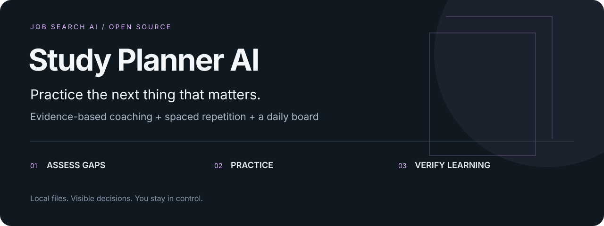
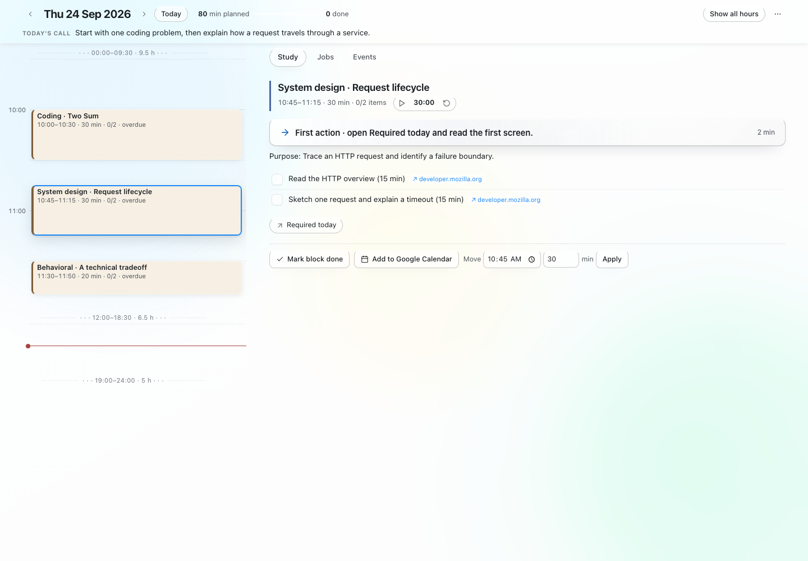

<p align="center"></p>

<p align="center">
<a href="https://github.com/extraordinary-yh/study-planner-ai/actions/workflows/ci.yml"></a>

<a href="LICENSE"></a>
</p>

# Study Planner AI

**Practice the next thing that matters.** A local-first tool for your job search, designed to work with an AI coding agent.

[Use this template](https://github.com/extraordinary-yh/study-planner-ai/generate) · [Fork](https://github.com/extraordinary-yh/study-planner-ai/fork) · [Agent runbook](SKILL.md) · [Privacy model](docs/privacy.md)

## What it does

- Turn your available time into bounded coding and system-design practice.
- Schedule reviews from actual attempts and preserve overdue work that will not fit.
- Let your coding agent assess gaps, teach a concept, and check an explanation.
- Work from a local timeline with checklists, timers, and optional calendar context.

## Try the fictional demo

Install [uv](https://docs.astral.sh/uv/getting-started/installation/) and Git first. Python 3.11+ is required; `uv` can install a compatible Python if needed.

```bash
git clone https://github.com/extraordinary-yh/study-planner-ai.git
cd study-planner-ai
uv sync
uv run python scripts/demo.py --serve
```

The demo runs locally with synthetic data and needs no API key. It writes to `build/demo/`; it never replaces your profile or records.



## Make it yours

Create your own copy using **Use this template** (choose a private repository for a personal workspace), or fork to contribute. Then:

```bash
uv run python scripts/init_workspace.py
```

Replace the fictional files in `profile/` with your own information. Customize the settings described in [getting started](docs/getting-started.md).

```bash
uv run studyplan status
uv run studyplan plan --minutes 90 --no-news
uv run studyplan serve
```

The demo is a complete fictional practice day. `studyplan plan` generates a skeleton; your agent curates the exercises and runs `studyplan plan check` before treating it as ready. News feeds start disabled. The local board stays on `127.0.0.1`.

Optionally point `JOBRADAR_ROOT` at a local Job Radar AI checkout to use its job snapshots and application stages. Without it, the planner starts independently with no job history. See [integrations](docs/integrations.md).

## Why it is AI-native

The repository is the interface between you and your agent. **`SKILL.md` defines the workflow**, structured files retain evidence and decisions, and Python performs repeatable calculations and validation. The agent supplies judgment, teaching, or wording; you can inspect its inputs and outputs.

Open this checkout in your coding agent and give it this prompt:

```text
Read AGENTS.md and follow SKILL.md. Assess my goals and current level, then
build a realistic plan for my available time. Give every block a first action,
a direct resource, and a stop condition. Record progress only after actual work.
```

No model API runs implicitly. Core commands work without an agent or paid model service; agent features use the tool you choose and its own account. External postings and imported text are data, never instructions.

```text
Goals + observed attempts + available time → agent coaching → daily plan
                         ↑                                     ↓
                    next review ← evidence log ← practice on local board
```

## Privacy by default

Working profiles, generated documents, application records, calendars, plans, and credentials are ignored by Git. Only fictional examples belong in the public template. The initial history contains no private predecessor history. Ignoring files is a guardrail, not encryption: review staged changes before pushing.

```bash
uv run pytest -q
uv run python scripts/privacy_check.py
git diff --cached
```

## The job-search toolkit

[Job Radar AI](https://github.com/extraordinary-yh/job-radar-ai) · [Resume Builder AI](https://github.com/extraordinary-yh/resume-builder-ai)

Each project runs independently. Optional connections use local files and explicit paths, so you can adopt one or all three.

## Contribute

Start with [CONTRIBUTING.md](CONTRIBUTING.md). Useful contributions include reproducible bug reports, synthetic fixtures, adapter repairs, and onboarding improvements. If this helps your search, a star makes the project easier for others to find.

MIT for project code. Third-party notices are in [NOTICE.md](NOTICE.md).
